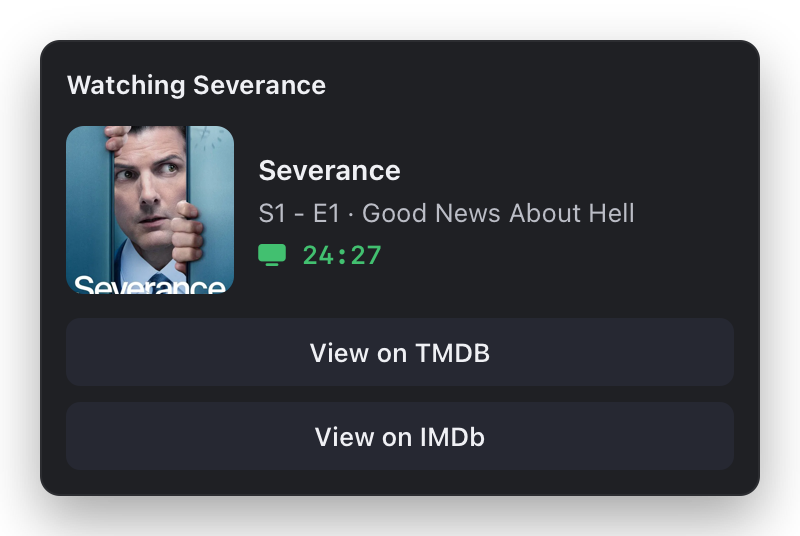
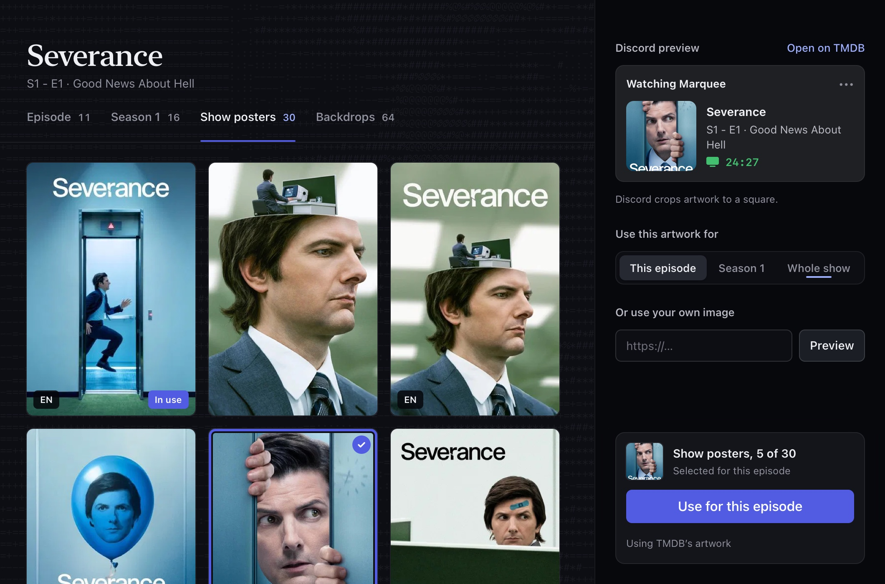

<div align="center">


# Marquee

**Show what you're watching on Discord, without doing anything.**<br>
Marquee sits in your menu bar or system tray, notices what your media player is playing,<br>
works out the exact movie or episode from the file name, and puts it on your Discord profile with the right artwork.


<br>



<sub>`American Horror Stories - S01E01 - Rubber (Wo)Man Part 1.mkv` → the right show, episode title and still, with no setup per file.</sub>

</div>

---

> [!NOTE]
> **macOS: "Apple could not verify Marquee"**<br>
> Marquee isn't signed with a paid Apple Developer ID, so macOS Gatekeeper may block it the first time. It isn't a virus: Marquee is open source and every download is built by GitHub Actions from this repository. To open it, go to **System Settings → Privacy & Security** and click **Open Anyway** (on macOS 14 and earlier, right-click Marquee.app → Open). [More details and a Terminal one-liner](#apple-could-not-verify-marquee-gatekeeper).

## Contents

- [Features](#features)
- [Supported players](#supported-players)
- [Install](#install)
- [Setup](#setup-5-minutes)
- [How identification works](#how-identification-works)
- [Choosing artwork](#choosing-artwork)
- [Fixing a wrong match](#fixing-a-wrong-match)
- [Discord card, buttons and privacy](#discord-card-buttons-and-privacy)
- [Watch history](#watch-history)
- [Stats](#stats)
- [Rules for players and folders](#rules-for-players-and-folders)
- [Moving your settings](#moving-your-settings)
- [Updates](#updates)
- [Configuration](#configuration)
- [Command line](#command-line)
- [Troubleshooting](#troubleshooting)
- [Building from source](#building-from-source)

## Features

- **Identifies files by name.** `Under THe Skin (2013).mp4`, `Breaking.Bad.S02E03.720p.mkv` and `Breaking Bad/Season 2/03.mkv` all resolve to the right TMDB entry, despite the release tags, odd capitalization and folder layouts. When no match is close enough, Marquee shows the cleaned-up file name rather than a wrong title.
- **Tracks playback.** Pausing, seeking, changing speed or switching files updates Discord within a couple of seconds. The progress bar uses the player's real position.
- **Reads embedded metadata.** Kodi, Jellyfin and Plex `.nfo` files, MP4 tags and Matroska tags are used before the file name, including the TMDB or IMDb id they carry.
- **Lets you fix mistakes.** **Fix Match…** searches TMDB so you can pick the right title for one file, a folder, or every file with that name.
- **Your card, your way.** Rewrite each line with templates, choose which link buttons appear and in what order, and keep titles, folders or genres off Discord.
- **Keeps a watch history.** Recently watched titles in the menu, with time watched and progress, stored only on your computer.
- **Shows your stats.** Hours this week against last week, a 12-week chart, your most-watched shows and movies, and your daily streak, all worked out from the local history.
- **Clears itself on a long pause.** Leave something paused and the card comes down after 15 minutes (or 5, 30, 60, never), then comes back the moment you press play.
- **Rules per player and folder.** Never show a folder, show a player without the title, or always show something your privacy lists would hide. Files a rule covers this way are never looked up on TMDB.
- **Moves with you.** Export settings, rules, Fix Match and artwork choices to one file and import them on another computer, merging or replacing. Your TMDB key stays out unless you include it.
- **Uses episode stills.** You can switch any episode, season or show to a different still, poster, backdrop or your own image from the artwork picker.
- **A moving backdrop for Settings.** A faint ASCII pattern behind the Settings window: the artwork of what you're watching drawn in characters, an aquarium, or a night sky. Turn it off or pick one in General; it holds still when Reduce Motion is on.
- **Stays out of the way.** About 16 MB of memory and no CPU while idle. Metadata is cached, and Discord or player restarts are handled without you doing anything.

## Supported players

**macOS:** IINA, VLC, mpv

**Windows:** VLC, mpv and mpv.net, MPC-HC, MPC-BE, Media Player, Movies & TV, QuickLook, PotPlayer, KMPlayer, GOM Player

For IINA, VLC, mpv and MPC-HC, choose **Set Up Players…** once and restart the player. It turns on the one setting each player needs to report what it's playing (IINA's mpv socket, VLC's local web interface, and so on) and leaves everything else alone. For MPC-BE, turn on *Options → Web Interface* yourself. The others need no setup.

Not every player reports the same detail:

- **IINA, mpv, VLC, MPC-HC, MPC-BE** report the full file path and the playback position, so you get the best matching and a progress bar.
- **Media Player and Movies & TV** report a title and position through Windows' media controls, but no path.
- **QuickLook, PotPlayer, KMPlayer and GOM** are read from the window title. That gives the file name only, with no progress bar.

## Install

### macOS

```bash
git clone https://github.com/xanaxfather/marquee.git && cd marquee
```
```bash
./scripts/bundle.sh && cp -R dist/Marquee.app /Applications/
```

Or download `marquee-macos.zip` from the [latest release](../../releases/latest). Open **Marquee** from Applications. Its icon appears in the menu bar, and a short welcome walks you through setup.

#### "Apple could not verify Marquee" (Gatekeeper)

The first time you open the downloaded app, macOS may refuse with a warning like **"Marquee" Not Opened: Apple could not verify "Marquee" is free of malware**, or **"Marquee" can't be opened because Apple cannot check it for malicious software**.

That warning is not a virus detection. macOS shows it for any app whose developer hasn't paid for an Apple Developer ID and sent each build to Apple to be notarized. Marquee is free and open source: every line of code is in this repository, the release builds are made by [GitHub Actions](../../actions/workflows/release.yml) straight from this source, and it never asks for your password. It only talks to Discord, TMDB, and GitHub (to check for updates). If you'd rather not trust a download at all, [build it yourself](#building-from-source) in two commands.

To open it anyway (you only need to do this once):

1. Move **Marquee.app** to Applications and double-click it. When the warning appears, click **Done** (or **Cancel**).
2. Open **System Settings → Privacy & Security** and scroll down to **Security**. You'll see *"Marquee" was blocked to protect your Mac*.
3. Click **Open Anyway**, confirm with your password or Touch ID, then click **Open Anyway** once more.

On macOS 14 (Sonoma) and earlier, **right-click** (or Control-click) Marquee.app, choose **Open**, then click **Open** in the dialog.

Or, from Terminal, remove the download flag macOS puts on the app:

```bash
xattr -dr com.apple.quarantine /Applications/Marquee.app
```

### Windows

Download `marquee-windows-x64.zip` from the [latest release](../../releases/latest), unzip it anywhere, and run `marquee.exe`. If Windows shows **Windows protected your PC** (SmartScreen does this for apps without a paid code-signing certificate), click **More info → Run anyway**. Its icon appears in the system tray (it may be in the overflow area at first; drag it out to keep it visible). To build it yourself, see [Building from source](#building-from-source).

> [!TIP]
> Turn on **Launch at login** (macOS) or **Start with Windows** in **Settings… → General** so Marquee is always running.

## Setup (5 minutes)

1. **Create a Discord application** at the [Discord Developer Portal](https://discord.com/developers/applications). Discord shows its name ("Watching **Movies**"), so pick something like *Movies* or *TV*. Copy the **Application ID**.
2. **Get a free TMDB key** from [TMDB API settings](https://www.themoviedb.org/settings/api). The v3 *API Key* and the v4 *Read Access Token* both work.
3. Paste both into the welcome window (or **Settings… → General** later).
4. Choose **Set Up Players**, then restart your player once.

Check everything at once:

```bash
marquee --diagnose
```

<details>
<summary>Example output</summary>

```
[ok  ] IINA set up
[ok  ] VLC set up
[ -- ] mpv not installed
[ok  ] discord_client_id set
[ok  ] Discord handshake as ken
[ok  ] TMDB API key accepted
```
</details>

## How identification works

Marquee first reads what's stored with the video: a Kodi/Jellyfin/Plex `.nfo` next to it (and `tvshow.nfo` in the show folder), iTunes-style MP4 tags, or Matroska tags. Then it builds a ranked list of guesses from the file name and the folder names. Each guess is scored against TMDB search results:

- **Title similarity** ignores case, accents, punctuation, articles and spacing, so `S.W.A.T.` matches `S W A T`.
- **Year** is a strong check: off by one is fine, anything further is rejected.
- **Origin country** helps with names like `The Office US`.
- **Popularity** only breaks ties.
- **Episode titles** in the file name confirm the episode, and find it when the numbering differs from TMDB's (year-numbered seasons, specials, re-cut seasons).

| File | Result |
|---|---|
| `Under THe Skin (2013).mp4` | **Under the Skin** (2013), not *Under the Skin* (1997) |
| `Breaking.Bad.S02E03.720p.WEB-DL.x264.mkv` | **Breaking Bad**, S2 - E3 · Bit by a Dead Bee |
| `Breaking Bad/Season 2/03 - Bit by a Dead Bee.mkv` | same, using the folder layout |
| `Under.the.Skin.2013.1080p.BluRay-GRP/grp-uts.mkv` | **Under the Skin** (2013), using the release folder |
| `The.Office.US.S05E14.mkv` | **The Office** (US), not the UK original |
| `Friends.S01E16E17.mkv` | **Friends**, S1 - E16–17 |
| `[SubsPlease] Sousou no Frieren - 12 (1080p).mkv` | **Frieren: Beyond Journey's End**, S1 - E12, found through its romanised title |
| `One Piece - 1071.mkv`, `Naruto Episode 135.mkv` | Absolute episode numbers, mapped onto TMDB's seasons |
| `Jeopardy! 2023-11-02.mp4` | The episode that aired that day |
| `Chernobyl 1of5.mkv` | **Chernobyl**, S1 - E1 |
| `Dark.Staffel.1.Folge.3.mkv` | **Dark**, S1 - E3 (also *Saison/Épisode*, *Temporada/Capítulo*) |
| `The Matrix (1999) {tmdb-603}.mkv` | Exactly that entry. `{imdb-tt…}` and `{tvdb-…}` tags work too, on the file or its folder |
| `2013 - Under the Skin.mkv`, `Blade.Runner.The.Final.Cut.1982.mkv` | Year-first names and edition names |
| `Tom and Jerry - S1940E01 - Puss Gets The Boot.mkv` | **Tom and Jerry** (1940), 1940 - E1. Year-numbered seasons are mapped to TMDB's numbering, and shows that premiered later are ruled out |
| `Wonder.Woman.1984.1080p.mkv` | **Wonder Woman 1984**, not *Wonder Woman* |
| `Dune (2021).mkv` | **Dune** (2021); the 1984 film is rejected on the year |

Try it on your own files with `marquee --parse <file>` (offline) or `marquee --lookup <file>` (TMDB).

## Choosing artwork



By default an episode shows its **episode still**, falling back to the season poster and then the show poster. Movies show their poster. To change it, choose **Choose Artwork…** while something is playing:

- Browse every still, season poster, show poster and backdrop TMDB has, or paste any `https://` image.
- Apply your choice to **this episode**, **this season** or **the whole show**. The most specific choice wins, and **Reset to default** undoes it.
- The preview shows the card the way Discord crops it.
- To choose artwork for a file before you play it, run `marquee --artwork-picker <file>`.

The picker uses each OS's built-in web view (WebKit on macOS, WebView2 on Windows). It exists only while open.

## Fixing a wrong match

Choose **Fix Match…** while the file plays. Search TMDB, pick the right movie or show, and choose whether it applies to **this file**, **this folder**, or **every file with the same name**. For a single episode you can also set the exact season and episode. **Go back to automatic matching** removes your choice.

## Discord card, buttons and privacy

**Settings… → Discord card** has a live preview of your card.

- **Templates** rewrite the title line, the second line and the artwork hover text, separately for episodes and movies. Placeholders: `{title}` `{year}` `{label}` (S2 - E3) `{season}` `{episode}` `{episode_title}` `{air_date}` `{air_year}` `{genres}` `{rating}` `{tagline}` `{player}`. A part between ` · ` separators disappears when its placeholders are empty, and `{tagline|title}` falls back to the title.
- **Buttons**: TMDB, IMDb, Letterboxd (movies), Trakt, Watch Trailer, Wikipedia, or your own link such as `https://example.com/?q={title}`. Discord shows the first two that apply.
- **Privacy**: list titles (or `Prefix*`), folders and genres to keep private, and choose whether they show nothing or a generic "Watching something". **Hide This Title** in the menu adds what's playing.
- **Clear after a long pause**: with **Show while paused** on, the card comes down after the player has been paused for 5, 15 (default), 30 or 60 minutes, and returns as soon as playback resumes.

## Watch history

**Recently Watched** in the menu lists the last ten titles with this week's watch time; choosing one plays the file again. **Settings… → History** has everything, with progress, time watched and filtering. History is stored in `history.json` next to the config and can be turned off under Privacy. Private titles, and files a rule hides or shows without a title, are never recorded.

## Stats

**Settings… → Stats** works out, from the watch history on your computer:

- hours watched this week (weeks start on Monday) against last week
- a bar chart of the last 12 weeks
- your five most-watched shows and movies (episodes of a show count together)
- your current and longest daily streak (a day counts after a minute of watching)

Nothing is sent anywhere. History recorded before Stats existed only has totals, so it counts on the day each title was last watched.

## Rules for players and folders

**Settings… → Privacy → Rules** lets you treat a player, a folder, or a player in a folder differently:

| Action | On Discord | Looked up on TMDB | Recorded in history |
|---|---|---|---|
| **Never show** | nothing | no | no |
| **Show without title** | "Watching something" | no | no |
| **Always show** | as usual, even if a privacy list matches | yes | yes |

A folder rule covers everything inside that folder (`~/` is your home folder). Folder matching ignores case on Windows and macOS. When several rules match, the most specific wins: a deeper folder beats a shallower one, any folder beats none, and naming a player beats "any player". Player names are the ones in the menu (`IINA`, `VLC`, `MPC-HC`, `Media Player`, …); `MPC` covers both MPC-HC and MPC-BE.

## Moving your settings

**Settings… → About → Back up and restore**:

- **Export…** saves your settings, rules, Fix Match choices and artwork choices to one JSON file in your Downloads folder and shows it. The TMDB key is left out unless you switch on **Include TMDB key**; the generated VLC password is never included.
- **Import…** checks the file and lists what would change before anything is saved. **Merge** keeps what you have and adds the file's settings on top (privacy lists, rules, Fix Match and artwork choices are combined). **Replace** makes everything what the file says, keeping your TMDB key if the file has none. Player connection paths from a different OS are left alone.

A file that isn't a Marquee export, is damaged, or comes from an older or newer export format is refused with a message, and nothing is changed. The files are only swapped in once everything has been written.

## Updates

Marquee checks GitHub for a new release once a day (turn it off in **Settings… → General**). When one is available, **Install Update…** in the menu downloads it, replaces the app and restarts it.

## Configuration

Everything is in **Settings…**. The same options live in a commented config file you can also edit by hand (**Settings… → About → Config file**).

| | macOS | Windows |
|---|---|---|
| Config | `~/Library/Application Support/Marquee/config.toml` | `%APPDATA%\Marquee\config.toml` |
| Logs | `~/Library/Logs/Marquee/` | `%LOCALAPPDATA%\Marquee\Logs\` |
| Cache | `~/Library/Caches/Marquee/` | `%LOCALAPPDATA%\Marquee\Cache\` |

<details>
<summary><b>All options</b></summary>

| Key | Default | What it does |
|---|---|---|
| `discord_client_id` | | Your Discord application's ID |
| `tmdb_api_key` | | TMDB v3 key or v4 read token |
| `language` | `en-US` | Language for titles and episode names |
| `artwork` | `episode` | Default image: `episode`, `season`, `poster` or `backdrop` |
| `show_when_paused` | `true` | Keep the presence (marked *Paused*) while paused |
| `idle_timeout` | `15` | Minutes paused before the presence is cleared (`0` = never); it returns on resume |
| `show_buttons` | `true` | Link buttons under the card |
| `buttons` | `["tmdb", "imdb"]` | Buttons in order: `tmdb`, `imdb`, `letterboxd`, `trakt`, `trailer`, `wikipedia`, or `"Label \| https://…{title}"` |
| `show_extras` | `true` | Genres and rating for movies, air date for episodes |
| `episode_details` / `episode_state` / `episode_image_text` | | Templates for episodes (empty = default) |
| `movie_details` / `movie_state` / `movie_image_text` | | Templates for movies (empty = default) |
| `hide_titles` / `hide_folders` / `hide_genres` | `[]` | Keep these off Discord |
| `privacy_mode` | `hide` | `hide` shows nothing, `generic` shows "Watching something" |
| `rules` | `[]` | Player / folder rules, e.g. `[{ player = "VLC", folder = "~/Movies/Home", action = "never" }]`; actions `never`, `generic`, `always` ([details](#rules-for-players-and-folders)) |
| `history` | `true` | Keep a local watch history |
| `check_updates` | `true` | Check GitHub for new versions daily |
| `status_display` | `details` | Member-list text: the title (`details`), the episode line (`state`) or the app name (`name`) |
| `small_image_playing` / `_paused` | Marquee's play/pause badges | Corner badge (asset key or URL, `""` for none) |
| `fallback_image` | | Image used when nothing is identified |
| `lowercase` | `false` | All-lowercase look for the Discord card, menu and notifications |
| `animated_background` | `true` | Faint animated pattern behind the Settings window (only runs while it's open and visible) |
| `background` | `still` | `still` (artwork of what's playing, or last watched, as characters), `aquarium` or `sky` |
| `ipc_socket` | `/tmp/marquee-iina.sock` | IINA's mpv socket |
| `mpv_ipc` | `/tmp/marquee-mpv.sock` · `\\.\pipe\marquee-mpv` | mpv / mpv.net endpoint |
| `vlc_port` / `vlc_password` | `8080` / generated | VLC web interface |
| `mpc_port` | `13579` | MPC-HC / MPC-BE web interface |
| `smtc_ignore` | `[]` | Windows media apps to ignore |
| `disabled_players` | `[]` | Turn watchers off: `IINA`, `mpv`, `VLC`, `MPC`, `SMTC`, `Windows` |
| `log_level` | `info` | `trace` … `error`; `RUST_LOG` overrides it |

</details>

## Command line

```text
marquee                          Run in the menu bar / system tray
marquee --headless               Run without a tray icon (logs to the terminal)
marquee --parse <path>           Show how a file name is interpreted
marquee --lookup <path>          Identify a file on TMDB and print the Discord payload
marquee --artwork-picker <path>  Choose artwork for a file without playing it
marquee --setup-players          Configure every installed player
marquee --diagnose               Check config, players, Discord and TMDB
```

Add `RUST_LOG=debug` to see match scores for every candidate, TMDB request times and player traffic. Log files are one JSON object per line, rotated daily, with seven days kept.

## Troubleshooting

<details>
<summary><b>I can't see the "View on TMDB" / "View on IMDb" buttons</b></summary>

Discord never shows your own activity's buttons to you. **Other people** see them on your profile. To check, look at your profile from a second account. To give you a link you can see yourself, Marquee also makes the **title and the artwork** clickable links to the TMDB page (in current Discord clients).
</details>

<details>
<summary><b>Nothing shows up on Discord</b></summary>

Run `marquee --diagnose`. The usual causes are: Discord isn't running, `discord_client_id` is missing, the player hasn't been restarted since **Set Up Players…**, or Discord's *Settings → Activity Privacy → Share your detected activities* is off.
</details>

<details>
<summary><b>The wrong title was matched</b></summary>

Choose **Fix Match…** and pick the right title. For whole libraries, add the year to file names (`Title (Year).mkv`), keep shows in `Show/Season N/` folders, or add `{tmdb-…}` tags or `.nfo` files. `marquee --lookup <file>` with `RUST_LOG=debug` shows why each candidate scored the way it did.
</details>

<details>
<summary><b>The menu says "config file has an error"</b></summary>

The config file isn't valid TOML (a stray character is enough). The exact line is in the log. Fix it, then choose **Settings… → About → Reload**.
</details>

## Building from source

Requires the stable [Rust toolchain](https://rustup.rs).

```bash
cargo test
```
```bash
cargo build --release
```

| Script | What it does |
|---|---|
| `scripts/bundle.sh` | Builds `dist/Marquee.app` (macOS) |
| `scripts/make_icon.swift` | Draws the app icon (`mac`, `win`, `small` variants) |
| `scripts/make_ico.py` | Builds the multi-size Windows `.ico` |

CI builds and tests on macOS and Windows for every push. The macOS app and the Windows `.exe` are attached to each run as artifacts.

<details>
<summary><b>Project layout</b></summary>

```
src/
├── main.rs          entry point, CLI
├── core.rs          event loop: picks the active player, keeps Discord in sync
├── players/         one watcher per player (mpv/IINA, VLC, MPC, SMTC, window titles)
├── setup/           "Set Up Players…" for each player
├── parse.rs         file name → title / year / season / episode guesses
├── matching.rs      scores TMDB results against a guess
├── metadata.rs      TMDB lookups + cache
├── presence.rs      builds the Discord activity
├── rules.rs         per-player / per-folder rules
├── backup.rs        settings export and import
├── discord.rs       Discord IPC client
├── ipc.rs           Unix socket / named pipe stream
├── tray.rs          menu bar / tray menu
├── picker.rs/.html  artwork picker window
└── platform.rs      paths, notifications, launch at login
```
</details>

---

<div align="center">
<sub>This product uses the TMDB API but is not endorsed or certified by TMDB.<br>
Not affiliated with Discord, IINA, VideoLAN, or any player listed above.</sub>
</div>
