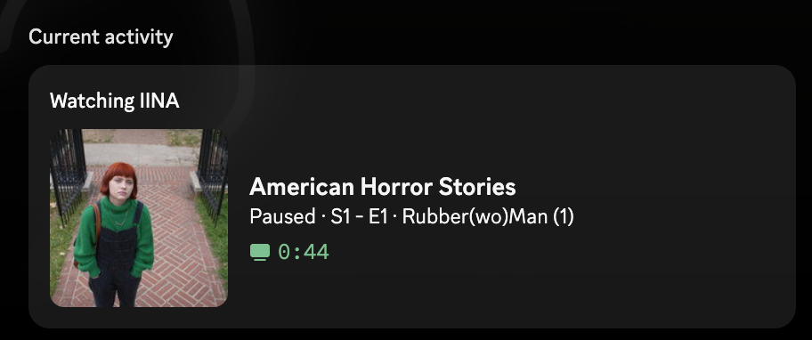
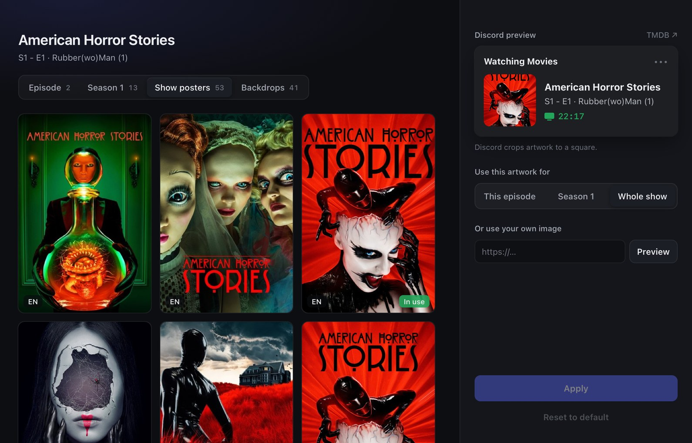

<div align="center">


# Marquee

**Show what you're watching on Discord, without doing anything.**<br>
Marquee sits in your menu bar or system tray, notices what your media player is playing,<br>
works out the exact movie or episode from the file name, and puts it on your Discord profile with the right artwork.


<br>



<sub>`American Horror Stories - S01E01 - Rubber (Wo)Man Part 1.mkv` → the right show, episode title and still, with no setup per file.</sub>

</div>

---

## Contents

- [Features](#features)
- [Supported players](#supported-players)
- [Install](#install)
- [Setup](#setup-5-minutes)
- [How identification works](#how-identification-works)
- [Choosing artwork](#choosing-artwork)
- [Configuration](#configuration)
- [Command line](#command-line)
- [Troubleshooting](#troubleshooting)
- [Building from source](#building-from-source)

## Features

<table>
<tr>
<td width="50%" valign="top">

### 🎬 Works out what you're watching
Reads names like `Under THe Skin (2013).mp4`, `Breaking.Bad.S02E03.720p.mkv` or `Season 2/03 - Bit by a Dead Bee.mkv` and matches them to the right title on TMDB. It handles odd capitalization, release tags, brackets, multi-episode files and folder layouts. If no match is confident enough, it shows the cleaned-up file name instead of guessing.

### 📺 Rich presence that keeps up
Shows title, season and episode, episode name, year, genres and rating, with a progress bar based on the real playback position. It updates when you pause, resume, seek, change speed or switch files.

</td>
<td width="50%" valign="top">

### 🖼️ Artwork you choose
Episode stills by default. Open the picker to choose any still, season poster, show poster or backdrop for one episode, one season or the whole show, or paste your own image URL.

### 🪶 Light by design
Event-driven where the player allows it (mpv and IINA send updates instead of being polled). About 16 MB of memory and 0% CPU when idle. It caches metadata, reconnects by itself, and copes with network problems and unknown files.

</td>
</tr>
</table>

## Supported players

| Player | macOS | Windows | How Marquee sees it | Setup |
|---|:---:|:---:|---|---|
| **IINA** | ✅ | | mpv IPC socket (push events) | automatic |
| **VLC** | ✅ | ✅ | VLC web interface (localhost) | automatic |
| **mpv / mpv.net** | ✅ | ✅ | mpv IPC socket / named pipe | automatic |
| **MPC-HC** | | ✅ | web interface (localhost) | automatic |
| **MPC-BE** | | ✅ | web interface (localhost) | turn on *Options → Web Interface* |
| **Media Player** (Windows 11), **Movies & TV** | | ✅ | Windows media controls | none |
| **QuickLook** (space-bar preview) | | ✅ | window title | none |
| **PotPlayer**, **KMPlayer**, **GOM Player** | | ✅ | window title | none |

"Automatic" means **Set Up Players…** in the menu changes just the setting that player needs and leaves its other settings alone. Restart the player once afterwards.

> [!NOTE]
> Windows' media controls and window titles don't give a file path or (for window titles) a playback position, so those players show a progress bar only when the player reports one.

## Install

### macOS

```bash
git clone https://github.com/xanaxfather/marquee.git && cd marquee
```
```bash
./scripts/bundle.sh && cp -R dist/Marquee.app /Applications/
```

Open **Marquee** from Applications. Its icon appears in the menu bar. There's no Dock icon and no window.

### Windows

Download `marquee-windows-x64.zip` from the latest successful [CI run](../../actions), unzip it anywhere, and run `marquee.exe`. Its icon appears in the system tray (it may be in the overflow area at first; drag it out to keep it visible). To build it yourself, see [Building from source](#building-from-source).

> [!TIP]
> Turn on **Launch at Login** (macOS) or **Start with Windows** in the menu so Marquee is always running.

## Setup (5 minutes)

1. **Create a Discord application** at the [Discord Developer Portal](https://discord.com/developers/applications). Discord shows its name ("Watching **Movies**"), so pick something like *Movies* or *TV*. Copy the **Application ID**.
2. **Get a free TMDB key** from [TMDB API settings](https://www.themoviedb.org/settings/api). The v3 *API Key* and the v4 *Read Access Token* both work.
3. Choose **Open Config File…** in the menu, paste both values, save, then choose **Reload Config**.
4. Choose **Set Up Players…**, then restart your player once.

Check everything at once:

```bash
marquee --diagnose
```

<details>
<summary>Example output</summary>

```
[ok  ] IINA set up
[ok  ] VLC set up
[ -- ] mpv not installed
[ok  ] discord_client_id set
[ok  ] Discord handshake as ken
[ok  ] TMDB API key accepted
```
</details>

## How identification works

Marquee builds a ranked list of guesses from the file name and then the folder names. Each guess is scored against TMDB search results:

- **Title similarity** ignores case, accents, punctuation, articles and spacing, so `S.W.A.T.` matches `S W A T`.
- **Year** is a strong check: off by one is fine, anything further is rejected.
- **Origin country** helps with names like `The Office US`.
- **Popularity** only breaks ties.

| File | Result |
|---|---|
| `Under THe Skin (2013).mp4` | **Under the Skin** (2013), not *Under the Skin* (1997) |
| `Breaking.Bad.S02E03.720p.WEB-DL.x264.mkv` | **Breaking Bad**, S2 - E3 · Bit by a Dead Bee |
| `Breaking Bad/Season 2/03 - Bit by a Dead Bee.mkv` | same, using the folder layout |
| `Under.the.Skin.2013.1080p.BluRay-GRP/grp-uts.mkv` | **Under the Skin** (2013), using the release folder |
| `The.Office.US.S05E14.mkv` | **The Office** (US), not the UK original |
| `Friends.S01E16E17.mkv` | **Friends**, S1 - E16–17 |
| `Wonder.Woman.1984.1080p.mkv` | **Wonder Woman 1984**, not *Wonder Woman* |
| `Dune (2021).mkv` | **Dune** (2021); the 1984 film is rejected on the year |

Try it on your own files with `marquee --parse <file>` (offline) or `marquee --lookup <file>` (TMDB).

## Choosing artwork



By default an episode shows its **episode still**, falling back to the season poster and then the show poster. Movies show their poster. To change it, choose **Choose Artwork…** while something is playing:

- Browse every still, season poster, show poster and backdrop TMDB has, or paste any `https://` image.
- Apply your choice to **this episode**, **this season** or **the whole show**. The most specific choice wins, and **Reset to default** undoes it.
- The preview shows the card the way Discord crops it.
- To choose artwork for a file before you play it, run `marquee --artwork-picker <file>`.

The picker uses each OS's built-in web view (WebKit on macOS, WebView2 on Windows). It exists only while open.

## Configuration

The config file is created with comments on first run. **Open Config File…** opens it.

| | macOS | Windows |
|---|---|---|
| Config | `~/Library/Application Support/Marquee/config.toml` | `%APPDATA%\Marquee\config.toml` |
| Logs | `~/Library/Logs/Marquee/` | `%LOCALAPPDATA%\Marquee\Logs\` |
| Cache | `~/Library/Caches/Marquee/` | `%LOCALAPPDATA%\Marquee\Cache\` |

<details>
<summary><b>All options</b></summary>

| Key | Default | What it does |
|---|---|---|
| `discord_client_id` | | Your Discord application's ID |
| `tmdb_api_key` | | TMDB v3 key or v4 read token |
| `language` | `en-US` | Language for titles and episode names |
| `artwork` | `episode` | Default image: `episode`, `season`, `poster` or `backdrop` |
| `show_when_paused` | `true` | Keep the presence (marked *Paused*) while paused |
| `show_buttons` | `true` | "View on TMDB" / "View on IMDb" buttons |
| `show_extras` | `true` | Genres and rating for movies, air date for episodes |
| `status_display` | `details` | Member-list text: the title (`details`), the episode line (`state`) or the app name (`name`) |
| `small_image_playing` / `_paused` | | Optional corner badge (asset key or URL) |
| `fallback_image` | | Image used when nothing is identified |
| `ipc_socket` | `/tmp/marquee-iina.sock` | IINA's mpv socket |
| `mpv_ipc` | `/tmp/marquee-mpv.sock` · `\\.\pipe\marquee-mpv` | mpv / mpv.net endpoint |
| `vlc_port` / `vlc_password` | `8080` / generated | VLC web interface |
| `mpc_port` | `13579` | MPC-HC / MPC-BE web interface |
| `smtc_ignore` | `[]` | Windows media apps to ignore |
| `disabled_players` | `[]` | Turn watchers off: `IINA`, `mpv`, `VLC`, `MPC`, `SMTC`, `Windows` |
| `log_level` | `info` | `trace` … `error`; `RUST_LOG` overrides it |

</details>

## Command line

```text
marquee                          Run in the menu bar / system tray
marquee --headless               Run without a tray icon (logs to the terminal)
marquee --parse <path>           Show how a file name is interpreted
marquee --lookup <path>          Identify a file on TMDB and print the Discord payload
marquee --artwork-picker <path>  Choose artwork for a file without playing it
marquee --setup-players          Configure every installed player
marquee --diagnose               Check config, players, Discord and TMDB
```

Add `RUST_LOG=debug` to see match scores for every candidate, TMDB request times and player traffic. Log files are one JSON object per line, rotated daily, with seven days kept.

## Troubleshooting

<details>
<summary><b>I can't see the "View on TMDB" / "View on IMDb" buttons</b></summary>

Discord never shows your own activity's buttons to you. **Other people** see them on your profile. To check, look at your profile from a second account. To give you a link you can see yourself, Marquee also makes the **title and the artwork** clickable links to the TMDB page (in current Discord clients).
</details>

<details>
<summary><b>Nothing shows up on Discord</b></summary>

Run `marquee --diagnose`. The usual causes are: Discord isn't running, `discord_client_id` is missing, the player hasn't been restarted since **Set Up Players…**, or Discord's *Settings → Activity Privacy → Share your detected activities* is off.
</details>

<details>
<summary><b>The wrong title was matched</b></summary>

Add the year to the file name (`Title (Year).mkv`) or keep shows in `Show/Season N/` folders. Then choose **Clear Metadata Cache**. `marquee --lookup <file>` with `RUST_LOG=debug` shows why each candidate scored the way it did.
</details>

<details>
<summary><b>The menu says "config file has an error"</b></summary>

The config file isn't valid TOML (a stray character is enough). The exact line is in the log. Fix it, then choose **Reload Config**.
</details>

## Building from source

Requires the stable [Rust toolchain](https://rustup.rs).

```bash
cargo test
```
```bash
cargo build --release
```

| Script | What it does |
|---|---|
| `scripts/bundle.sh` | Builds `dist/Marquee.app` (macOS) |
| `scripts/make_icon.swift` | Draws the app icon (`mac`, `win`, `small` variants) |
| `scripts/make_ico.py` | Builds the multi-size Windows `.ico` |

CI builds and tests on macOS and Windows for every push. The macOS app and the Windows `.exe` are attached to each run as artifacts.

<details>
<summary><b>Project layout</b></summary>

```
src/
├── main.rs          entry point, CLI
├── core.rs          event loop: picks the active player, keeps Discord in sync
├── players/         one watcher per player (mpv/IINA, VLC, MPC, SMTC, window titles)
├── setup/           "Set Up Players…" for each player
├── parse.rs         file name → title / year / season / episode guesses
├── matching.rs      scores TMDB results against a guess
├── metadata.rs      TMDB lookups + cache
├── presence.rs      builds the Discord activity
├── discord.rs       Discord IPC client
├── ipc.rs           Unix socket / named pipe stream
├── tray.rs          menu bar / tray menu
├── picker.rs/.html  artwork picker window
└── platform.rs      paths, notifications, launch at login
```
</details>

---

<div align="center">
<sub>This product uses the TMDB API but is not endorsed or certified by TMDB.<br>
Not affiliated with Discord, IINA, VideoLAN, or any player listed above.</sub>
</div>
